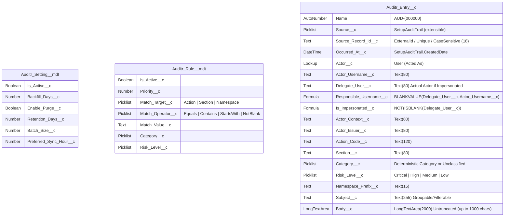

# SF-Auditr: Data Model & Architecture Design Proposal (v2)

**SF-Auditr** is an open-source Salesforce Setup Audit Trail intelligence and security monitoring package, designed as a sibling to **Logr** (`Logr` for runtime logs, `SF-Auditr` for immutable Setup & security audit history).

---

## 1. Verified Findings from `logrDevHub` (API v68.0)

Before finalizing v2 of this design, we ran `sf sobject describe --sobject SetupAuditTrail` and inspected all 216 live `SetupAuditTrail` rows in `logrDevHub`:

| Field on `SetupAuditTrail` | Verified API Type & Max Length | Filterable / Groupable in SOQL | Notes from Live Org Inspection |
| :--- | :--- | :--- | :--- |
| `Id` | `id (18)` | Yes / Yes | Prefix `0Ym`. |
| `Action` | `string (120)` | Yes / Yes | 70 distinct `(Action, Section)` pairs in `logrDevHub`. Note: Flows log `createdinteractiondefinition` and `activatedinteractiondefinition`, which `SAT Reporting`'s hardcoded `interactiondefversion` filter misses! |
| `Section` | `string (40)` | **No** / Yes | Can be `null` (e.g., `PermissionSelfHealing`, `deleteScratchOrg`, org preference toggles). |
| `CreatedDate` | `datetime` | Yes / No | Indexed timestamp of the event. |
| `CreatedById` | `reference (18)` | Yes / Yes | Can be `null` for automated system processes. When impersonating, holds the **impersonated** user. |
| `Display` | `string (1000)` | **No / No** | Max platform length is **`1,000` characters** (longest in `logrDevHub` is `205` chars). Not filterable or groupable in SOQL. |
| `DelegateUser` | `string (80)` | Yes / Yes | Holds the actual actor's username/identifier during Login-As or Salesforce Support sessions (`suloginaccessused`). Must remain Text, not a `Lookup(User)`. |
| `ResponsibleNamespacePrefix` | `string (15)` | Yes / Yes | Populated when a managed/unlocked package triggers the Setup change. |
| `CreatedByContext` | `string (80)` | Yes / Yes | Context string for the actor. |
| `CreatedByIssuer` | `string (80)` | Yes / Yes | Identity/SSO issuer for the actor. |

* **`SAT Reporting` Master-Detail Confirmed**: [`Setup_Audit_Trail__c.field-meta.xml`](file:///Users/nitheshnekkanti/Repos/SF-Auditr/.reference/SAT-Reporting/main/default/objects/SetupAuditTrailItems__c/fields/Setup_Audit_Trail__c.field-meta.xml) in `SAT Reporting` is confirmed `<type>MasterDetail</type>` with `<sharingModel>ControlledByParent</sharingModel>`.

---

## 2. Core Design Pillars (v2 Upgrades)

1. **Tamper-Resistant Source Evidence + Reclassifiable Enrichments**:
   * `Auditr_Entry__c` rows are **insert-only** during sync (`Database.insert(newRecords, false)`).
   * Neither `Auditr_Admin` nor `Auditr_Viewer` grants Create, Edit, Delete, or Modify All on `Auditr_Entry__c` (and `Auditr_Admin` includes `ViewSetup` so the sync user always has permission to read `SetupAuditTrail`).
   * **`AuditrEntryTrigger` (`before update, before delete`)** locks all **13 raw source fields** (`Source__c`, `Source_Record_Id__c`, `Occurred_At__c`, `Actor__c`, `Actor_Username__c`, `Delegate_User__c`, `Actor_Context__c`, `Actor_Issuer__c`, `Action_Code__c`, `Section__c`, `Namespace_Prefix__c`, `Subject__c`, `Body__c`) so they can never be modified after insertion, while allowing **`Category__c`** and **`Risk_Level__c`** to be updated when `AuditrReclassifyBatch` runs after new `Auditr_Rule__mdt` rules are added.
   * **Field History Tracking** is enabled strictly on `Category__c` and `Risk_Level__c` so every classification change is audited.
   * Deletes are blocked in `before delete` unless `AuditrEntryTriggerHandler.allowPurgeDelete == true` (set inside each `AuditrPurgeBatch.execute()` transaction).
2. **Accurate Attribution (`Responsible_Username__c` vs `Actor__c`)**:
   * Verified: `SetupAuditTrail.DelegateUser` stores the username of the Login-As admin (or the Salesforce Support agent identifier during `suloginaccessused`).
   * `Auditr_Entry__c` defines:
     * `Actor__c` / `Actor_Username__c`: Labeled **Acted As (User)** / **Acted As Username**.
     * `Delegate_User__c`: Labeled **Delegate User**.
     * `Responsible_Username__c` (`Formula Text`): `BLANKVALUE(Delegate_User__c, Actor_Username__c)`. Every "by user" report, scorecard, and dashboard chart groups by `Responsible_Username__c`.
     * `Is_Impersonated__c` (`Formula Checkbox`): `NOT(ISBLANK(Delegate_User__c))`. Strictly flags changes made *while* impersonating.
3. **Declarative Classification Engine (`Auditr_Rule__mdt`) + Reclassify Batch (`AuditrReclassifyBatch`)**:
   * Priority-ordered Custom Metadata rules (`Auditr_Rule__mdt`) map events to `Category__c` and `Risk_Level__c`.
   * Unmatched actions default to `Category__c = 'Unclassified'` and `Risk_Level__c = 'Low'`.
   * When admins add new rules, `AuditrReclassifyBatch` re-evaluates existing `Unclassified` (or all) rows and updates only `Category__c` and `Risk_Level__c`.
4. **Indexed Watermark Query (`ORDER BY CreatedDate DESC LIMIT 1`), Verified `QueryLocator`, & Stale-Sync Alerting**:
   * **Verified in `logrDevHub`**: `Database.getQueryLocator` on `SetupAuditTrail` works natively in Apex v68.0 (`QUERY_LOCATOR_SUCCESS`).
   * Because `Occurred_At__c` is a custom DateTime field and not indexed by default, `AuditrSyncBatch` queries `SELECT Occurred_At__c, CreatedDate FROM Auditr_Entry__c WHERE Source__c = 'SetupAuditTrail' ORDER BY CreatedDate DESC LIMIT 1` (using Salesforce's system index on `CreatedDate`) and ingests `SetupAuditTrail` in `ORDER BY CreatedDate ASC` order, subtracting a 2-day overlap window (`Occurred_At__c.addDays(-2)`).
   * **Stale-Sync Detection**: `AuditrController.getStatus()` checks whether the scheduled `CronTrigger` owner is active, whether the last `AsyncApexJob` failed, and whether the last sync is >36 hours old, surfacing an immediate warning banner in the Home Page LWC Control Center.

---

## 3. Redesigned Data Model (v2)

### 3.1 Custom Object: `Auditr_Entry__c` (Auditr Entry)
* **Sharing Model:** `Private`
* **Track Field History:** `true` (secondary detection layer on top of `AuditrEntryTrigger` immutability)
* **Permissions:** `Auditr_Admin` and `Auditr_Viewer` grant `Read` + `View All Records` ONLY (`allowCreate=false`, `allowEdit=false`, `allowDelete=false`, `modifyAllRecords=false`).

| Field Label | API Name | Data Type | Attributes & Source Mapping |
| :--- | :--- | :--- | :--- |
| **Source** | `Source__c` | `Picklist` | Required, default `SetupAuditTrail`. Future-proofs the schema for `LoginHistory` or other event streams. |
| **Source Record ID** | `Source_Record_Id__c` | `Text(18)` | **Required, External ID, Unique (Case-Sensitive)**. Stores `SetupAuditTrail.Id` (`0Ym...`). |
| **Occurred At** | `Occurred_At__c` | `DateTime` | **Required**. Maps from `SetupAuditTrail.CreatedDate`. |
| **Acted As (User)** | `Actor__c` | `Lookup(User)` | `DeleteConstraint: SetNull`. Maps from `SetupAuditTrail.CreatedById`. |
| **Acted As Username** | `Actor_Username__c` | `Text(80)` | Snapshot of `CreatedBy.Username` (or `'System'` when `CreatedById` is null). |
| **Delegate User** | `Delegate_User__c` | `Text(80)` | Maps from `SetupAuditTrail.DelegateUser` (the actual human when using Login-As or Support access). |
| **Responsible Username** | `Responsible_Username__c` | `Formula (Text)` | `BLANKVALUE(Delegate_User__c, Actor_Username__c)`. Used by all "by user" reports and scorecards. |
| **Is Impersonated** | `Is_Impersonated__c` | `Formula (Checkbox)` | `NOT(ISBLANK(Delegate_User__c))`. True only for actions performed while impersonating another user. |
| **Actor Context** | `Actor_Context__c` | `Text(80)` | Maps from `SetupAuditTrail.CreatedByContext`. |
| **Actor Issuer** | `Actor_Issuer__c` | `Text(80)` | Maps from `SetupAuditTrail.CreatedByIssuer`. |
| **Action Code** | `Action_Code__c` | `Text(120)` | Maps from `SetupAuditTrail.Action`. |
| **Section** | `Section__c` | `Text(80)` | Maps from `SetupAuditTrail.Section` (defaults to `'General'` if blank on `SetupAuditTrail`). |
| **Category** | `Category__c` | `Picklist` | `Security & Access`, `Users & Sessions`, `Code & Automation`, `Data & Schema`, `Packages & Integrations`, `Org Preferences`, `Unclassified`. |
| **Risk Level** | `Risk_Level__c` | `Picklist` | `Critical`, `High`, `Medium`, `Low`. |
| **Namespace Prefix** | `Namespace_Prefix__c` | `Text(15)` | Maps from `SetupAuditTrail.ResponsibleNamespacePrefix`. |
| **Subject** | `Subject__c` | `Text(255)` | First 255 characters of `SetupAuditTrail.Display` (truncated with `...` if `Display > 255` chars) for report grouping and filtering. |
| **Body** | `Body__c` | `LongTextArea(2000)` | Untruncated `SetupAuditTrail.Display` (verified max length on `SetupAuditTrail` is `1,000` characters). |

---

### 3.2 Custom Metadata Type 1: `Auditr_Setting__mdt` (Auditr Setting)
Ships with `Auditr_Setting.Default.md-meta.xml`:

| Field Label | API Name | Data Type | Default (`Default` Record) | Purpose |
| :--- | :--- | :--- | :--- | :--- |
| **Is Active** | `Is_Active__c` | `Checkbox` | `true` | Master switch for scheduled sync execution. |
| **Backfill Days** | `Backfill_Days__c` | `Number(3,0)` | `180` | Days of history to import when `Auditr_Entry__c` has no records. |
| **Enable Purge** | `Enable_Purge__c` | `Checkbox` | `false` | **Opt-in only** (`false` by default so audit records are kept forever unless explicitly enabled). |
| **Retention Days** | `Retention_Days__c` | `Number(5,0)` | `0` | Only used when `Enable_Purge__c = true` and `Retention_Days__c > 0`. |
| **Batch Size** | `Batch_Size__c` | `Number(4,0)` | `2000` | Scope size for `AuditrSyncBatch` and `AuditrPurgeBatch`. |
| **Preferred Sync Hour** | `Preferred_Sync_Hour__c` | `Number(2,0)` | `2` | Default daily schedule hour (0-23). |

---

### 3.3 Custom Metadata Type 2: `Auditr_Rule__mdt` (Auditr Classification Rule)
Evaluated in ascending `Priority__c` order (first match wins; unmatched rows get `Category__c = 'Unclassified'`, `Risk_Level__c = 'Low'`):

| Field Label | API Name | Data Type | Purpose |
| :--- | :--- | :--- | :--- |
| **Is Active** | `Is_Active__c` | `Checkbox` | Whether this rule is active. |
| **Priority** | `Priority__c` | `Number(5,0)` | Evaluation order (`10`, `20`, `30`... lowest number evaluated first). |
| **Match Target** | `Match_Target__c` | `Picklist` | `Action`, `Section`, `NamespacePrefix`, or `DelegateUser`. |
| **Match Operator** | `Match_Operator__c` | `Picklist` | `Equals`, `Contains`, `StartsWith`, `NotBlank`. |
| **Match Value** | `Match_Value__c` | `Text(255)` | Case-insensitive value to match against `Match_Target__c`. |
| **Category** | `Category__c` | `Picklist` | Single deterministic category assigned when matched. |
| **Risk Level** | `Risk_Level__c` | `Picklist` | Single deterministic risk level (`Critical`, `High`, `Medium`, `Low`) assigned when matched. |

---

## 4. Apex, Trigger, LWC & Dashboard Architecture

1. **Apex & Trigger Layer**:
   * `AuditrEntryTrigger.trigger` + `AuditrEntryTriggerHandler.cls`: Enforces strict immutability (`before update` always adds error; `before delete` adds error unless `AuditrPurgeBatch.isPurgeContext == true`).
   * `AuditrUtil.cls`: Loads `Auditr_Setting__mdt` and active `Auditr_Rule__mdt` records (ordered by `Priority__c ASC`), evaluates the first matching rule, and constructs `Auditr_Entry__c` rows.
   * `AuditrSyncBatch.cls` (`Database.Batchable<SObject>, Schedulable`): Queries `SetupAuditTrail` from `min(latestOccurredAt - 2 days, now - 2 days)` (or `now - Backfill_Days__c` on initial backfill), skips already-ingested `Source_Record_Id__c` values per batch chunk, and inserts new `Auditr_Entry__c` rows. If `Enable_Purge__c == true` and `Retention_Days__c > 0`, chains `AuditrPurgeBatch` in `finish()`.
   * `AuditrPurgeBatch.cls` (`Database.Batchable<SObject>`): Dedicated batch job for opt-in retention purging so deletes never hit the 10,000-row DML limit.
   * `AuditrController.cls`: `@AuraEnabled` + `@InvocableMethod` endpoints for the Home Page LWC Control Center.
2. **Dashboard Type (`SpecifiedUser` vs `LoggedInUser`)**:
   * Because Salesforce caps `LoggedInUser` (Dynamic) Dashboards at 3 in Developer Edition and 5 in Enterprise Edition, and **2GP package installation automatically rewrites `<runningUser>` on `SpecifiedUser` dashboards to the installing admin**, we can use `SpecifiedUser` for the packaged dashboard (consuming 0 dynamic dashboard slots) while documenting how admins can switch it if desired.
