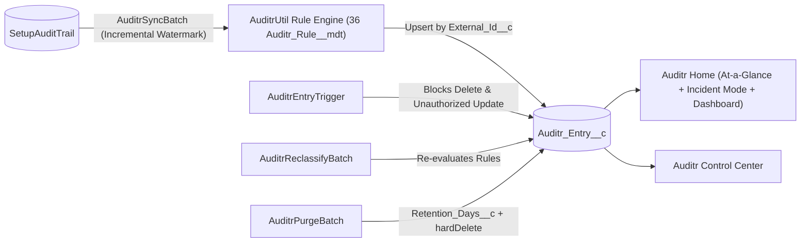

<p align="center">
  
</p>

# Auditr for Salesforce

[](https://developer.salesforce.com/)
[](https://developer.salesforce.com/)
[](LICENSE)

**Long-term, classified Setup Audit Trail history inside your org.** Auditr syncs `SetupAuditTrail` into tamper-resistant `Auditr_Entry__c` records, classifies every change by risk level and category using Custom Metadata rules, and gives admins an **Incident Mode** time-window investigator, a **Control Center**, reports, and a security dashboard.

---

## What Auditr does

- **Retains Setup Audit Trail beyond 180 days.** `AuditrSyncBatch` incrementally syncs `SetupAuditTrail` using an indexed `External_Id__c` watermark (`Database.upsert(..., External_Id__c, false)`) so duplicate rows are never created.
- **Tamper-resistant records.** `AuditrEntryTrigger` blocks `before delete` entirely and blocks `before update` on every audit field except classification fields (`Category__c`, `Risk_Level__c`, `Matched_Rule__c`, `Is_Classified__c`) during an explicit `AuditrReclassifyBatch` run.
- **Metadata-driven classification.** Ships with 36 `Auditr_Rule__mdt` rules (`EXACT`, `STARTS_WITH`, `CONTAINS`, `REGEX`) evaluated in priority order across `Critical`, `High`, `Medium`, and `Low` risk levels and 6 domain categories (`Security & Access`, `Users & Sessions`, `Code & Automation`, `Data & Schema`, `Org Preferences`, `Packages & Integrations`).
- **Impersonation & delegate tracking.** Automatically computes `Is_Impersonated__c` and `Responsible_Username__c` when changes are made via delegated admin or *Log in As*.
- **At-a-Glance + Incident Mode (`auditrAtAGlance`).** 6-KPI rolling summary strip (`Total Events`, `Critical & High`, `Security & Access`, `Automation & Code`, `Impersonated`, `Unclassified`) with reader-friendly compact numbers (`25K`, `1.5M`), window filters (up to 1 year), and an expandable **Incident Mode** investigator to pinpoint changes around an exact incident timestamp.
- **Custom Read-Only Detail Component (`auditrRecordDetail`).** Enforces immutable audit provenance (Section, Action Code, Responsible Actor, Delegate User, Context, Timestamp, Display) with zero inline editing pencils, while allowing authorized admins to reclassify Risk Level & Category in a dedicated modal.
- **Field History Tracking.** Built-in field history tracking across all audit entry fields with a dedicated `Histories` tab on the record page.
- **Control Center (`auditrControlCenter`).** Run **Sync Now**, schedule daily automated sync and daily retention purge side-by-side, trigger **Reclassify Unclassified** or **Reclassify All**, run **Retention Purge** on demand, inspect top unclassified setup actions (last 30 days), monitor recent batch runs, and search active classification rules.
- **Reports & Security Dashboard.** 6 pre-built reports and a 6-widget `Auditr_Security_Dashboard` embedded directly on the **Auditr Home** page.

---

## Data Retention & Purge Management

By default, Auditr retains all `Auditr_Entry__c` records indefinitely to ensure compliance with long-term audit and SOC 2 / ISO 27001 requirements. For orgs with strict data lifecycle or storage limits, configure retention in **Setup → Custom Metadata Types → Auditr Setting**:

- **`Auditr_Setting__mdt.Enable_Purge__c`**: Boolean toggle controlling whether expired records can be purged (default: `false`).
- **`Auditr_Setting__mdt.Retention_Days__c`**: Retention threshold in days (default: `720`). Records where `Occurred_At__c < (NOW - Retention_Days)` become eligible for deletion when `Enable_Purge__c` is `true`.
- **Controlled Immutability Bypass**: `AuditrEntryTrigger` prevents deletion by any user. Only `AuditrPurgeBatch` can delete expired rows by explicitly setting `AuditrEntryTriggerHandler.allowPurgeDelete = true` within its execution scope.
- **Scheduled Daily Purge (Control Center)**: Pick a **Daily Purge Hour (Org Time Zone)** and click **Schedule Daily Purge** directly in the Control Center (or click **Run Retention Purge** in the header for an immediate one-off run).
- **Scheduled Purge via Apex**:
  ```apex
  // Schedule daily retention purge at 3 AM via AuditrController
  AuditrController.scheduleDailyPurge(3);
  ```

---

## Install & Set Up

### 1. Install Unlocked Package (Recommended)

Install the latest unlocked package build (`v1.0.0-5`) in any sandbox, scratch org, or production environment:

```bash
sf package install --package 04tg7000000cCPxAAM --target-org <alias> --wait 10
```

*Or install directly via your browser:*  
`https://login.salesforce.com/packaging/installPackage.apexp?p0=04tg7000000cCPxAAM`

---

### 2. Or Deploy from Source

```bash
sf project deploy start --source-dir force-app/main/default/Auditr --target-org <alias>
```

### 3. Assign Permission Sets

- **`Auditr_Admin`** — Full access to the Auditr app, Control Center operations, Setup Audit Trail sync/reclassification, and read-all access to `Auditr_Entry__c`.
- **`Auditr_Viewer`** — Read-only auditor access to `Auditr_Entry__c`, Auditr Home, Incident Mode, reports, and dashboards.

```bash
sf org assign permset --name Auditr_Admin --target-org <alias>
```

### 4. Run Initial Sync & Schedule Daily Sync

Open the **Auditr** app from the Lightning App Launcher → **Auditr Control Center** → click **Sync Now** and **Schedule Daily**, or run via Apex:

```apex
Database.executeBatch(new AuditrSyncBatch(), 2000);
System.schedule('Auditr Daily Sync', '0 0 2 * * ?', new AuditrSyncBatch());
```

---

## Architecture



```text
force-app/main/default/Auditr/
├── applications/    Auditr Lightning App (branded with Auditr_Logo)
├── classes/         AuditrUtil · AuditrEntryTriggerHandler · AuditrSyncBatch
│                    AuditrReclassifyBatch · AuditrPurgeBatch · AuditrController
│                    + 5 test classes (AuditrTestDataFactory, etc.)
├── triggers/        AuditrEntryTrigger (immutability enforcement)
├── lwc/             auditrAtAGlance · auditrControlCenter · auditrRecordDetail
├── objects/         Auditr_Entry__c · Auditr_Rule__mdt · Auditr_Setting__mdt
├── layouts/         Auditr_Entry__c · Auditr_Rule__mdt · Auditr_Setting__mdt layouts
├── customMetadata/  36 classification rules + Default setting (720-day retention)
├── flexipages/      Auditr_Home · Auditr_Control_Center · Auditr_Entry_Record_Page
├── dashboards/      Auditr_Security_Dashboard (6 components)
├── reports/         6 audit & security reports
└── permissionsets/  Auditr_Admin · Auditr_Viewer
```

## License

MIT.
