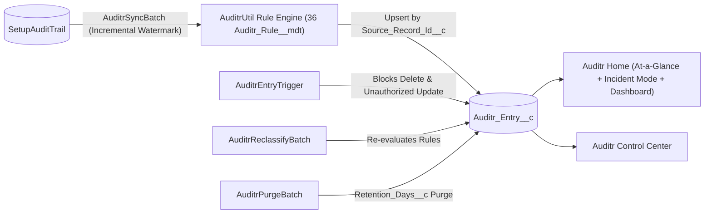

<p align="center">
  
</p>

# Auditr for Salesforce

[](https://developer.salesforce.com/)
[](https://developer.salesforce.com/)
[](<>)
[](https://nithesh1992.github.io/Auditr/)
[](LICENSE)

**Documentation:** <https://nithesh1992.github.io/Auditr/>

**Long-term, classified Setup Audit Trail history inside your org.** Auditr incrementally syncs `SetupAuditTrail` into tamper-resistant `Auditr_Entry__c` records, classifies every admin and metadata change by risk level and security domain using Custom Metadata rules, and gives admins an **Incident Mode** time-window investigator, an operational **Control Center**, native Lightning reports, and a security dashboard.

**Classified fields on `Auditr_Entry__c`:**

```text
Name:                    AUD-0001428
Occurred_At__c:          2026-11-01T14:22:09.000Z
Risk_Level__c:           Critical
Category__c:             Security & Access
Section__c:              Manage Users
Action_Code__c:          PermSetAssign
Responsible_Username__c: contractor@acme.example.com (via Delegate_User__c)
Actor_Username__c:       sysadmin@acme.example.com
Is_Impersonated__c:      true
Display__c:              Assigned Permission Set "Modify_All_Data" to user john.doe@acme.example.com
```

---

## Is Auditr right for you?

**Pick Auditr if** you want to retain Setup Audit Trail beyond Salesforce's 180-day limit inside your org, classify changes by risk level (`Critical`, `High`, `Medium`, `Low`), investigate incidents by time window, and own a small, transparent codebase.

**Pick native `SetupAuditTrail` if** a 180-day rolling CSV download with no risk classification or Lightning reports is sufficient for your org.

**Pick Salesforce Shield / External SIEM if** you require real-time streaming event monitoring, field audit trail archival across millions of standard object rows, or enterprise SOC alerting outside Salesforce.

---

## What Auditr does

- **Retains Setup Audit Trail beyond 180 days.** `AuditrSyncBatch` incrementally syncs `SetupAuditTrail` using an indexed `Source_Record_Id__c` external ID watermark (`Database.upsert(..., Source_Record_Id__c, false)`) with a 1-hour overlap buffer so duplicate rows are never created and late-committed setup events are never missed.
- **Tamper-resistant records.** `AuditrEntryTrigger` blocks `before delete` entirely (unless invoked by `AuditrPurgeBatch`) and blocks `before update` on every provenance field, allowing updates only to `Category__c` and `Risk_Level__c` during an authorized reclassification.
- **Metadata-driven classification.** Ships with 36 `Auditr_Rule__mdt` rules (`Equals`, `StartsWith`, `Contains`, `NotBlank`) evaluated in `Priority__c` order across `Critical`, `High`, `Medium`, and `Low` risk levels and 6 domain categories (`Security & Access`, `Users & Sessions`, `Code & Automation`, `Data & Schema`, `Org Preferences`, `Packages & Integrations`).
- **Impersonation & delegate tracking.** Automatically computes `Is_Impersonated__c` and `Responsible_Username__c` when changes are made via delegated admin or *Log in As*.
- **At-a-Glance + Incident Mode (`auditrAtAGlance`).** 6-KPI rolling summary strip (`Total Events`, `Critical & High`, `Security & Access`, `Automation & Code`, `Impersonated`, `Unclassified`) with compact numbers (`25K`, `1.5M`), window filters (up to 1 year), and an expandable **Incident Mode** investigator (`±15m` to `±4h` around an incident timestamp).
- **Custom Read-Only Detail Component (`auditrRecordDetail`).** Enforces immutable audit provenance with zero inline editing pencils while allowing authorized admins to reclassify Risk Level & Category in a dedicated modal.
- **Field History Tracking.** Built-in field history tracking across audit entry fields with a dedicated `Histories` tab on the record page.
- **Control Center (`auditrControlCenter`).** Run **Sync Now**, schedule daily automated sync and daily retention purge side-by-side, trigger **Reclassify Unclassified** or **Reclassify All**, run **Retention Purge** on demand, inspect top unclassified setup actions (last 30 days), monitor recent batch runs, and search active classification rules.
- **Reports & Security Dashboard.** 6 pre-built reports and a 6-widget `Auditr_Security_Dashboard` embedded directly on the **Auditr Home** page.

---

## How it compares

| Capability | **Auditr** | Native `SetupAuditTrail` |
| :--- | :--- | :--- |
| **Retention window** | **Indefinite or custom (`Retention_Days__c`)** | 180 days (CSV download) |
| **Risk classification (`Critical`..`Low`)** | **Built-in (`36 Auditr_Rule__mdt` rules)** | None |
| **Domain categorization** | **6 normalized categories + custom rules** | Raw `Section` text only |
| **Impersonation / Login-As attribution** | **`Is_Impersonated__c` + `Responsible_Username__c`** | Raw `DelegateUser` column |
| **Incident time-window investigator** | **Built-in Incident Mode (`±15m` to `±4h`)** | Manual CSV grep |
| **Native Lightning Reports & Dashboards** | **6 reports + 6-widget Security Dashboard** | Not supported on `SetupAuditTrail` |
| **Tamper protection** | **Trigger-enforced immutability + Field History** | System read-only |

---

## Data Retention & Purge Management

By default, Auditr retains all `Auditr_Entry__c` records indefinitely (`Enable_Purge__c = false`). For orgs with strict data lifecycle or storage limits, configure retention in **Setup → Custom Metadata Types → Auditr Setting**:

- **`Auditr_Setting__mdt.Enable_Purge__c`**: Boolean toggle controlling whether expired records can be purged (default: `false`).
- **`Auditr_Setting__mdt.Retention_Days__c`**: Retention threshold in days (default: `720`). Records where `Occurred_At__c < (NOW - Retention_Days)` become eligible for deletion when `Enable_Purge__c` is `true`.
- **Controlled Immutability Bypass**: `AuditrEntryTrigger` prevents deletion by any user. Only `AuditrPurgeBatch` can delete expired rows by explicitly setting `AuditrEntryTriggerHandler.allowPurgeDelete = true` within its execution scope.
- **Scheduled Daily Purge (Control Center)**: Pick a **Daily Purge Hour (Org Time Zone)** in the red schedule card and click **Schedule Daily Purge** directly in the Control Center (or click **Run Retention Purge** in the header for an immediate one-off run).
- **Scheduled Purge via Apex**:
  ```apex
  AuditrController.scheduleDailyPurge(3);
  ```

---

## Known limitations

- **Near-real-time batch sync (not streaming).** `SetupAuditTrail` does not support Apex triggers or Change Data Capture. Auditr ingests entries via `AuditrSyncBatch` on a daily schedule or when an admin clicks **Sync Now**.
- **Initial backfill is bounded by Salesforce's 180-day `SetupAuditTrail` window.** On the day you install Auditr, `SetupAuditTrail` only holds the last 180 days of history. Multi-year retention accumulates forward from the date of installation.
- **Custom Object storage consumption.** Each `Auditr_Entry__c` record consumes standard Salesforce data storage (~2 KB per record). Use `Enable_Purge__c` and `Retention_Days__c` in `Auditr_Setting__mdt` to manage storage growth in high-volume orgs.
- **Defensive LDV query caps.** To keep UI components responsive in orgs with large audit volumes, `AuditrController` caps KPI count queries (`25,000` for total counts, `5,000` per category/risk KPI, and `10,000` for 30-day unclassified aggregation).

---

## Install

**Unlocked package (`Auditr@1.0.0-5`)**

```bash
sf package install --package 04tg7000000cCPxAAM --target-org <alias> --wait 10
```

Production: <https://login.salesforce.com/packaging/installPackage.apexp?p0=04tg7000000cCPxAAM>  
Sandbox: <https://test.salesforce.com/packaging/installPackage.apexp?p0=04tg7000000cCPxAAM>

**From source**

```bash
git clone https://github.com/nithesh1992/Auditr.git && cd Auditr
sf project deploy start --source-dir force-app/main/default/Auditr --target-org <alias>
```

## Set up

1. **Assign Permission Sets.**
   - **`Auditr_Admin`** — Full access to the Auditr app, Control Center operations, Setup Audit Trail sync/reclassification, and read-all access to `Auditr_Entry__c`.
   - **`Auditr_Viewer`** — Read-only auditor access to `Auditr_Entry__c`, Auditr Home, Incident Mode, reports, and dashboards.
   ```bash
   sf org assign permset --name Auditr_Admin --target-org <alias>
   ```
2. **Run Initial Sync & Schedule Daily Sync.** Open the **Auditr** app from the Lightning App Launcher → **Auditr Control Center** → click **Sync Now** and **Schedule Daily Sync**, or run via Apex:
   ```apex
   AuditrController.runSyncNow();
   AuditrController.scheduleDailySync(2);
   ```

---

## Architecture



```text
force-app/main/default/Auditr/
├── applications/    Auditr Lightning App (branded with Auditr_Logo)
├── classes/         AuditrUtil · AuditrEntryTriggerHandler · AuditrSyncBatch
│                    AuditrReclassifyBatch · AuditrPurgeBatch · AuditrController
│                    + 5 test classes (AuditrTestDataFactory, etc.)
├── triggers/        AuditrEntryTrigger (immutability enforcement)
├── lwc/             auditrAtAGlance · auditrControlCenter · auditrRecordDetail
├── objects/         Auditr_Entry__c · Auditr_Rule__mdt · Auditr_Setting__mdt
├── layouts/         Auditr_Entry__c · Auditr_Rule__mdt · Auditr_Setting__mdt layouts
├── customMetadata/  36 classification rules + Default setting (720-day retention)
├── flexipages/      Auditr_Home · Auditr_Control_Center · Auditr_Entry_Record_Page
├── dashboards/      Auditr_Security_Dashboard (6 components)
├── reports/         6 audit & security reports
└── permissionsets/  Auditr_Admin · Auditr_Viewer
```

## License

MIT. See [LICENSE](LICENSE).
