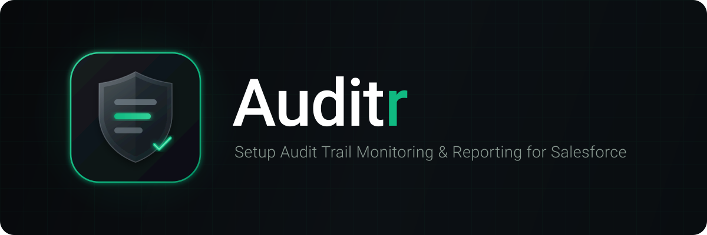
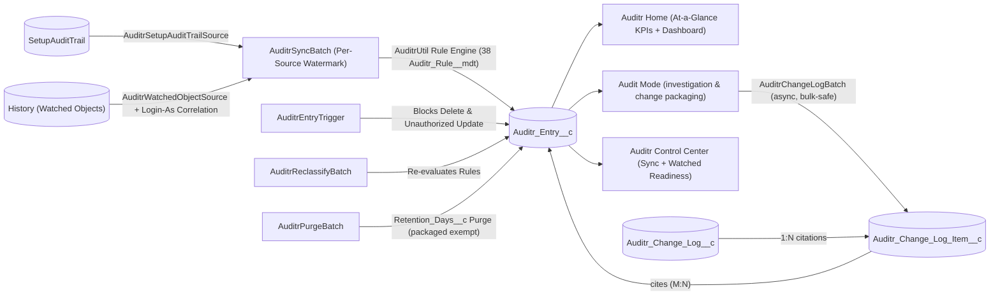

<p align="center">
  
</p>

# Auditr for Salesforce

[](https://developer.salesforce.com/)
[](https://developer.salesforce.com/)
[](<>)
[](https://nithesh1992.github.io/Auditr/)
[](LICENSE)

**Documentation:** <https://nithesh1992.github.io/Auditr/>

**Long-term, classified Setup Audit Trail & Watched Object history inside your org — with compliance change packaging.** Auditr incrementally syncs `SetupAuditTrail` and opt-in **Watched Objects** (via standard Salesforce Field History Tracking, capturing *which* fields changed, *who* changed them, and *when* — never field values) into `Auditr_Entry__c` records through a pluggable `AuditrSource` adapter framework. It blocks edits and deletes through normal use, classifies each event by risk level and security domain using Custom Metadata rules, and organizes work into focused tabs: **Auditr Home** (posture KPIs + dashboard), **Audit Mode** (unified incident investigation across sources, actor bursts, and compliance change packaging into sealed, CR-bound change logs), **Auditr Control Center** (sync, Watched Object readiness, retention, and rule operations), and **Change Logs** (lifecycle and sign-offs).

**Classified fields on `Auditr_Entry__c`:**

```text
Name:                    AUD-0001428
Occurred_At__c:          2026-11-01T14:22:09.000Z
Risk_Level__c:           Critical
Category__c:             Security & Access
Section__c:              Manage Users
Action_Code__c:          PermSetAssign
Responsible_Username__c: contractor@acme.example.com (via Delegate_User__c)
Actor_Username__c:       sysadmin@acme.example.com
Is_Impersonated__c:      true
Display__c:              Assigned Permission Set "Modify_All_Data" to user john.doe@acme.example.com
```

---

## Is Auditr right for you?

**Pick Auditr if** you want to retain Setup Audit Trail beyond Salesforce's 180-day limit inside your org, classify changes by risk level (`Critical`, `High`, `Medium`, `Low`), investigate incidents by time window, and own a small, transparent codebase.

**Pick native `SetupAuditTrail` if** a 180-day rolling CSV download with no risk classification or Lightning reports is sufficient for your org.

**Pick Salesforce Shield / External SIEM if** you require real-time streaming event monitoring, field audit trail archival across millions of standard object rows, or enterprise SOC alerting outside Salesforce.

---

## What Auditr does

- **Pluggable Multi-Source Ingestion (`AuditrSource` + `Auditr_Source__mdt`).** `AuditrSyncBatch` dispatches one independent batch job per active source adapter so a failure in one source never blocks another. Every source inherits per-source watermark + overlap replay, `Source_Record_Id__c` deduplication, and stateful partial-DML failure surfacing.
- **Watched Objects (`Auditr_Watched_Object__mdt` + `AuditrWatchedObjectSource`).** Monitor sensitive standard or custom objects via standard Salesforce Field History Tracking — **without Shield and without storing confidential field values**. Auditr records only *which fields changed*, *who* changed them, *when*, and on *which record* (`Target_Object__c`, `Target_Record_Id__c`), grouping consecutive changes by the same user on the same record at the exact same timestamp into a single entry (splitting immediately on any interruption) and surviving record deletion. Investigators click straight through to the record's native History related list when they need before/after values.
- **Retains Setup Audit Trail beyond 180 days.** `AuditrSetupAuditTrailSource` incrementally syncs `SetupAuditTrail` using an indexed `Source_Record_Id__c` external ID watermark with a 2-day overlap buffer and in-chunk deduplication (`Database.insert(..., false)`), inspecting row-level `SaveResult` records so duplicates are prevented and late-committed setup events within the overlap window are captured.
- **Blocks edits and deletes through normal use.** `AuditrEntryTrigger` blocks `before delete` unless `AuditrPurgeBatch.execute` is on the call stack, and blocks `before update` on all source/provenance fields so only `Category__c` and `Risk_Level__c` can be reclassified.
- **Metadata-driven classification.** Ships with 38 `Auditr_Rule__mdt` rules (`Equals`, `StartsWith`, `Contains`, `NotBlank`) evaluated in `Priority__c` order across `Critical`, `High`, `Medium`, and `Low` risk levels and 6 domain categories (`Security & Access`, `Users & Sessions`, `Code & Automation`, `Data & Schema`, `Org Preferences`, `Packages & Integrations`), scoped by `Source__c` (`SetupAuditTrail`, `DataChange`) with `TargetObject`, `ChangedField`, and `DelegateUser` matching for Watched Objects.
- **Impersonation & Login-As correlation (Setup & Data).** Automatically computes `Is_Impersonated__c` and `Responsible_Username__c` when Setup changes are made via delegated admin or *Log in As*, and correlates Watched Object Field History saves against active `suOrgAdminLogin` / `suOrgAdminLogout` session windows in `SetupAuditTrail` to infer `Delegate_User__c` (displaying a conditional warning banner on the record page noting that standard Field History does not record session IDs).
- **Auditr Home At-a-Glance (`auditrAtAGlance`).** 7-KPI rolling summary strip (`Total Events`, `Critical & High`, `Security & Access`, `Automation & Code`, `Impersonated`, `Unclassified`, **`Unassigned Changes`** — entries with no change log citation) with compact numbers (`25K`, `1.5M`) and window filters (up to 1 year).
- **Incident Mode (`auditrIncidentMode`).** Dedicated tab that pinpoints every setup change within `±15m` to `±12h` of an incident timestamp, auto-anchored to the newest synced event.
- **Audit Mode & Change Packaging (`auditrAuditMode`).** Compliance workspace that surfaces the **unassigned changes backlog** (entries with no citation — SOX ITGC unauthorized-change exceptions) and packages them into `Auditr_Change_Log__c` containers tied to a mandatory, format-validated `Change_Request_Id__c`. Citations are `Auditr_Change_Log_Item__c` junction records with a compound unique key, so one event can serve multiple audit scopes (release manifest, incident bundle, SOX review). Packaging runs asynchronously via `AuditrChangeLogBatch` for 10,000+ entry release windows. Sealed logs are fully immutable and stamp auditor sign-off automatically.
- **Multi-Source Schema (`Setup Audit Trail`, `Watched Object`, and reserved `Login History`).** `Auditr_Entry__c` ships active pipelines for `SetupAuditTrail` and `DataChange` (Watched Objects), plus a reserved `Login_History` record type for optional future Login History adapters.
- **Custom Read-Only Detail Component (`auditrRecordDetail`).** Renders source provenance fields, Watched Object target links, and changed-field pills read-only with no inline editing pencils, displays a conditional **Inferred Login-As Delegation** warning banner when a Watched Object change is correlated with an active Login-As window, and lets admins reclassify Risk Level & Category.
- **Field History Tracking.** Built-in field history tracking across audit entry fields with a dedicated `Histories` tab on the record page.
- **Control Center (`auditrControlCenter`).** Shows the last `AsyncApexJob` status and completed time for `AuditrSyncBatch` alongside the age of the newest entry's `Occurred_At__c`, lets admins run **Sync Now**, schedule daily sync and daily retention purge side-by-side, trigger **Reclassify Unclassified** or **Reclassify All**, run **Retention Purge** (packaged evidence exempt), inspect **Watched Objects (Field History)** readiness (`FieldDefinition.IsFieldHistoryTracked` validation), inspect top unclassified setup actions (last 30 days), and search active classification rules.
- **Reports & Security Dashboard.** 6 pre-built reports and a 6-widget `Auditr_Security_Dashboard` embedded directly on the **Auditr Home** page.

---

## How it compares

| Capability | **Auditr** | Native `SetupAuditTrail` |
| :--- | :--- | :--- |
| **Retention window** | **Indefinite or custom (`Retention_Days__c`)** | 180 days (CSV download) |
| **Risk classification (`Critical`..`Low`)** | **Built-in (`36 Auditr_Rule__mdt` rules)** | None |
| **Domain categorization** | **6 normalized categories + custom rules** | Raw `Section` text only |
| **Impersonation / Login-As attribution** | **`Is_Impersonated__c` + `Responsible_Username__c`** | Raw `DelegateUser` column |
| **Incident time-window investigator** | **Built-in Incident Mode (`±15m` to `±12h`)** | Manual CSV grep |
| **Change bundling to Change Requests** | **Sealed `Auditr_Change_Log__c` packages (async, M:N citations)** | None |
| **Unassigned-change governance** | **Backlog KPI + Audit Mode workspace (SOX ITGC alignment)** | None |
| **Native Lightning Reports & Dashboards** | **6 reports + 6-widget Security Dashboard** | Not supported on `SetupAuditTrail` |
| **Edit & delete protection** | **Blocks edits/deletes through normal use + Field History** | System read-only |

---

## Data Retention & Purge Management

By default, Auditr retains all `Auditr_Entry__c` records indefinitely (`Enable_Purge__c = false`). For orgs with strict data lifecycle or storage limits, configure retention in **Setup → Custom Metadata Types → Auditr Setting**:

- **`Auditr_Setting__mdt.Enable_Purge__c`**: Boolean toggle controlling whether expired records can be purged (default: `false`).
- **`Auditr_Setting__mdt.Retention_Days__c`**: Retention threshold in days (default: `720`). Records where `Occurred_At__c < (NOW - Retention_Days)` become eligible for deletion when `Enable_Purge__c` is `true`.
- **Packaged Evidence Exemption**: Entries cited by any `Auditr_Change_Log_Item__c` are always excluded from `AuditrPurgeBatch` — sealed compliance evidence is never deleted by retention policy.
- **Call-Stack-Gated Purge**: `AuditrEntryTrigger` blocks `before delete` unless `new DmlException().getStackTraceString().contains('AuditrPurgeBatch.execute')`, tying deletion directly to `AuditrPurgeBatch`'s execution context without a public static flag.
- **Scheduled Daily Purge (Control Center)**: Pick a **Daily Purge Hour (Org Time Zone)** in the red schedule card and click **Schedule Daily Purge** directly in the Control Center (or click **Run Retention Purge** in the header for an immediate one-off run).
- **Scheduled Purge via Apex**:
  ```apex
  AuditrController.scheduleDailyPurge(3);
  ```

---

## Known limitations

- **Standard Field History boundaries & deletion blind spot on Watched Objects.** Watched Objects rely on standard Salesforce Field History Tracking (up to 20 tracked fields per object without Shield, 1-second timestamp precision, and no tracking on formula/roll-up/long-text fields). Auditr captures only metadata (*which fields changed*, *who*, and *when* — never `OldValue`/`NewValue`) and does not capture record reads, reports/exports, or streaming Event Monitoring logs. Because Salesforce Field History only writes `<Object>History` rows on `insert` and `update`, **record deletions (`after delete`) do not generate a Field History row**; furthermore, if a record is deleted and hard-purged from the Recycle Bin *before* the next `AuditrSyncBatch` run, Salesforce cascade-deletes its `<Object>History` rows prior to ingestion (whereas entries already synced into `Auditr_Entry__c` survive record deletion). Orgs requiring deletion auditing should pair Field History with a lightweight `after delete` trigger or Change Data Capture (CDC).
- **Save-run `Source_Record_Id__c` anchoring & `Watched_Fields__c` updates.** `AuditrWatchedObjectSource` anchors `Source_Record_Id__c` to the first `<Object>History.Id` of each consecutive `(parentId, actorId, occurredAt)` save run — even when that first row is an unwatched field — so adding or removing fields in `Watched_Fields__c` never creates duplicate `Auditr_Entry__c` records during the 48-hour overlap window. Because `Auditr_Entry__c` provenance fields are immutable after insertion, changes to `Watched_Fields__c` apply to newly ingested saves forward and do not rewrite already-ingested entries.
- **Inferred Login-As delegation on Watched Objects.** Standard `<Object>History` tables do not store a `DelegateUser` or `SessionId` column. `AuditrLoginAsCorrelator` infers `Delegate_User__c` by correlating the history row's timestamp with bounded `[earliest - 120m, latest + 5m]` windows from `SetupAuditTrail` (`suOrgAdminLogin`/`suOrgAdminLogout`, `suNetworkAdminLogin`/`suNetworkAdminLogout`, `suloginaccessused`/`suLogout` across both `DelegateUser` and `Display` target formats) and active `AuthSession` substitute sessions (`SessionType = 'SubstituteUser'` / `LoginType = 'SysAdmin Switch'`), and surfaces a warning banner on the record page (and `(Inferred)` tag in Audit Mode) noting that concurrent activity by the original user in a separate browser session is still possible.
- **Blocks edits and deletes through normal use (not cryptographic immutability).** A user with permission to disable triggers or modify Apex in the org could still alter or remove records.
- **Near-real-time batch sync (not streaming).** `SetupAuditTrail` and `<Object>History` are ingested via `AuditrSyncBatch` on a daily schedule or when an admin clicks **Sync Now**.
- **Initial backfill is bounded by Salesforce's native history window.** On the day you install Auditr, `SetupAuditTrail` holds the last 180 days of setup history and `<Object>History` holds history from the point Field History Tracking was enabled on each object. Multi-year retention accumulates forward in `Auditr_Entry__c`.
- **Custom Object storage consumption.** Each `Auditr_Entry__c` record consumes standard Salesforce data storage (~2 KB per record). `Auditr_Change_Log_Item__c` citations consume ~2 KB each but are only created for packaged entries. Use `Enable_Purge__c` and `Retention_Days__c` in `Auditr_Setting__mdt` to manage storage growth in high-volume orgs.
- **Defensive LDV query caps.** To keep UI components responsive in orgs with large audit volumes, `AuditrController` caps KPI count queries (`25,000` for total counts, `5,000` per category/risk KPI, and `10,000` for 30-day unclassified aggregation).

---

## Roadmap

- **Optional `LoginHistory` adapter**: Plug-in `AuditrSource` adapter for filtered login anomaly ingestion (`Failed` logins, non-corporate IPs) with storage-conscious throttling.
- **ITSM verification sync**: Live two-way validation of `Change_Request_Id__c` approvals against ServiceNow / Jira (external integration plugin).
- **Export to external systems**: Offloading classified `Auditr_Entry__c` records to an external system / SIEM or object storage prior to retention purge (planned roadmap item, not currently implemented).
- **AI-assisted Incident Mode narratives**: Grouping multi-day audit windows into per-actor trail stories to speed up root-cause triage.

---

## Install

**Unlocked package (`Auditr@1.3.0-1`)**

```bash
sf package install --package 04tg7000000e1YTAAY --target-org <alias> --wait 10
```

Production: <https://login.salesforce.com/packaging/installPackage.apexp?p0=04tg7000000e1YTAAY>  
Sandbox: <https://test.salesforce.com/packaging/installPackage.apexp?p0=04tg7000000e1YTAAY>

**From source**

```bash
git clone https://github.com/nithesh1992/Auditr.git && cd Auditr
sf project deploy start --source-dir force-app/main/default/Auditr --target-org <alias>
```

## Set up

1. **Assign Permission Sets.**
   - **`Auditr_Admin`** — Full access to the Auditr app, Control Center operations, Setup Audit Trail sync/reclassification, and read-all access to `Auditr_Entry__c`.
   - **`Auditr_Viewer`** — Read-only auditor access to `Auditr_Entry__c`, Auditr Home, Incident Mode, reports, and dashboards.
   ```bash
   sf org assign permset --name Auditr_Admin --target-org <alias>
   ```
2. **Run Initial Sync & Schedule Daily Sync.** Open the **Auditr** app from the Lightning App Launcher → **Auditr Control Center** → click **Sync Now** and **Schedule Daily Sync**, or run via Apex:
   ```apex
   AuditrController.runSyncNow();
   AuditrController.scheduleDailySync(2);
   ```

---

## Architecture



```text
force-app/main/default/Auditr/
├── applications/    Auditr Lightning App (branded with Auditr_Logo)
├── classes/         AuditrSource · AuditrSetupAuditTrailSource · AuditrWatchedObjectSource
│                    AuditrLoginAsCorrelator · AuditrUtil · AuditrEntryTriggerHandler
│                    AuditrSyncBatch · AuditrReclassifyBatch · AuditrPurgeBatch
│                    AuditrController · AuditrChangeLogController · AuditrChangeLogBatch
│                    AuditrChangeLogTriggerHandler · AuditrChangeLogItemTriggerHandler
│                    + 8 test classes (AuditrSourceTest, AuditrTestDataFactory, etc.)
├── triggers/        AuditrEntryTrigger · AuditrChangeLogTrigger · AuditrChangeLogItemTrigger
├── lwc/             auditrAtAGlance · auditrAuditMode
│                    auditrControlCenter · auditrRecordDetail
├── objects/         Auditr_Entry__c · Auditr_Change_Log__c · Auditr_Change_Log_Item__c
│                    Auditr_Source__mdt · Auditr_Watched_Object__mdt
│                    Auditr_Rule__mdt · Auditr_Setting__mdt
├── layouts/         Auditr_Entry__c · Auditr_Change_Log__c · Rule/Setting layouts
├── customMetadata/  38 classification rules + Setup_Audit_Trail source + Account_Example watched object + Default setting
├── flexipages/      Auditr_Home · Auditr_Audit_Mode
│                    Auditr_Control_Center · Auditr_Entry_Record_Page
├── dashboards/      Auditr_Security_Dashboard (6 components)
├── reports/         6 audit & security reports
└── permissionsets/  Auditr_Admin · Auditr_Viewer
```

## License

MIT. See [LICENSE](LICENSE).
