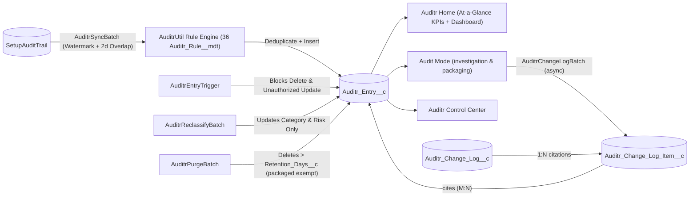

# Architecture, Data Model & Considerations

Auditr is intentionally compact — 10 production Apex classes, 3 triggers, 4 Lightning Web Components, 3 custom objects, 1 custom permission, and 2 custom metadata types — so your security and engineering teams can audit the entire codebase in minutes.

---

## Package Structure

```text
force-app/main/default/Auditr/
├── applications/        Auditr Lightning App (branded with Auditr_Logo)
├── classes/             AuditrUtil · AuditrEntryTriggerHandler · AuditrSyncBatch
│                        AuditrReclassifyBatch · AuditrPurgeBatch · AuditrController
│                        AuditrChangeLogController · AuditrChangeLogBatch
│                        AuditrChangeLogTriggerHandler · AuditrChangeLogItemTriggerHandler
│                        + 9 test classes (AuditrTestDataFactory, etc.)
├── triggers/            AuditrEntryTrigger · AuditrChangeLogTrigger · AuditrChangeLogItemTrigger
├── lwc/                 auditrAtAGlance · auditrAuditMode
│                        auditrControlCenter · auditrRecordDetail
├── objects/             Auditr_Entry__c · Auditr_Change_Log__c · Auditr_Change_Log_Item__c
│                        Auditr_Rule__mdt · Auditr_Setting__mdt
├── layouts/             Auditr_Entry__c · Auditr_Change_Log__c · Rule/Setting layouts
├── customMetadata/      36 classification rules + Default setting
├── customPermissions/   Auditr_Admin_Access
├── flexipages/          Auditr_Home · Auditr_Audit_Mode
│                        Auditr_Control_Center · Auditr_Entry_Record_Page
├── dashboards/          Auditr_Security_Dashboard (6 components)
├── reports/             6 audit & security reports
└── permissionsets/      Auditr_Admin · Auditr_Viewer
```

---

## End-to-End Pipeline



1. **Watermark Resolution (`AuditrSyncBatch.resolveCutoffTimestamp`)**:
   - Queries the newest `Auditr_Entry__c.Occurred_At__c` where `Source__c = 'SetupAuditTrail'`.
   - Subtracts a **2-day overlap buffer** (`DEFAULT_OVERLAP_DAYS = 2`) so late-committed `SetupAuditTrail` rows are never missed across batch boundaries.
   - If no `Auditr_Entry__c` rows exist yet, falls back to `System.now().addDays(-Backfill_Days__c)`.
2. **Deduplication and Partial DML (`Source_Record_Id__c`)**:
   - Maps `String.valueOf(SetupAuditTrail.Id)` into `Auditr_Entry__c.Source_Record_Id__c` (`External ID`, `Unique`, `Case Insensitive`).
   - Filters out existing IDs within each batch chunk, inserts new records via `Database.insert(newEntries, false, AccessLevel.SYSTEM_MODE)`, and inspects `Database.SaveResult[]` to record accurate successful insert counts and log any failed rows.
3. **Privilege & Permission Boundary (`Auditr_Admin_Access`)**:
   - All privileged operations (Sync Now, Reclassify, Purge, Scheduling, Change Log creation, and Packaging) are explicitly authorized by the `Auditr_Admin_Access` custom permission granted via the `Auditr_Admin` permission set.
4. **Edit & Delete Protection (`AuditrEntryTrigger` & `AuditrEntryTriggerHandler`)**:
   - **`before delete`**: Blocks deletions through normal use unless `new DmlException().getStackTraceString().contains('AuditrPurgeBatch.execute')`, tying deletion directly to `AuditrPurgeBatch`'s execution context without a public static flag.
   - **`before update`**: Blocks any modification to source and attribution fields (`Source__c`, `Source_Record_Id__c`, `Occurred_At__c`, `Actor__c`, `Actor_Username__c`, `Delegate_User__c`, `Responsible_Username__c`, `Actor_Context__c`, `Action_Code__c`, `Section__c`, `Namespace_Prefix__c`, `Display__c`), allowing only `Category__c` and `Risk_Level__c` to be reclassified.
5. **Sealing Guard Against In-Flight Packaging**:
   - `AuditrChangeLogTriggerHandler` enforces that `Auditr_Change_Log__c` cannot transition to `Sealed` while an asynchronous packaging batch (`Packaging_Job_Id__c`) is actively in flight, ensuring sealed logs represent the complete requested audit scope.

---

## Data Model (`Auditr_Entry__c`)

| Field Label | API Name | Type | Description |
| :--- | :--- | :--- | :--- |
| **Audit Entry Number** | `Name` | Auto Number (`AUD-{0000000}`) | Unique human-readable audit identifier. |
| **Occurred At** | `Occurred_At__c` | Date/Time | Original `SetupAuditTrail.CreatedDate` timestamp. |
| **Risk Level** | `Risk_Level__c` | Picklist | `Critical`, `High`, `Medium`, or `Low`. |
| **Category** | `Category__c` | Picklist | `Security & Access`, `Users & Sessions`, `Code & Automation`, `Data & Schema`, `Org Preferences`, `Packages & Integrations`, or `Unclassified`. |
| **Setup Section** | `Section__c` | Text(120) | Setup section where the change occurred (defaults to `General` when blank). |
| **Action Code** | `Action_Code__c` | Text(120) | Raw `SetupAuditTrail.Action` identifier. |
| **Responsible Username** | `Responsible_Username__c` | Text(255) | Resolved actor (`Delegate_User__c` when impersonated, otherwise `Actor_Username__c`). |
| **Actor** | `Actor__c` | Lookup(`User`) | Lookup to the `CreatedById` User record. |
| **Actor Username** | `Actor_Username__c` | Text(255) | Snapshot of `CreatedBy.Username` at the time of the event (defaults to `System` for automated actions). |
| **Delegate User** | `Delegate_User__c` | Text(255) | Populated when an admin acts via *Log in As* or delegated administration. |
| **Is Impersonated** | `Is_Impersonated__c` | Formula (Checkbox) | `NOT(ISBLANK(Delegate_User__c))` — flags delegated/impersonated actions for reports and list views. |
| **Actor Context** | `Actor_Context__c` | Text(80) | `SetupAuditTrail.CreatedByContext` value. |
| **Namespace Prefix** | `Namespace_Prefix__c` | Text(80) | `SetupAuditTrail.ResponsibleNamespacePrefix` value. |
| **Display** | `Display__c` | Long Text Area(32768) | Full human-readable description of the setup change. |
| **Payload** | `Payload__c` | Long Text Area(32768) | Reserved compact JSON payload for Phase 2 high-velocity sources (unused for SetupAuditTrail). |
| **Source** | `Source__c` | Picklist | Audit source (`SetupAuditTrail`; `LoginHistory` and `DataChange` reserved for Phase 2). |
| **Source Record ID** | `Source_Record_Id__c` | Text(64) (External ID, Unique) | 18-character `SetupAuditTrail.Id` used for chunk deduplication. |

::: warning Reserved Schema Foundation
The `Login History` and `Data Change` record types as well as the `Payload__c` long text field on `Auditr_Entry__c` are strictly reserved schema placeholders. Current ingestion pipelines, permission models, retention policies, and unit tests exclusively govern `SetupAuditTrail`. Multi-source ingestion will be introduced in future releases alongside dedicated pipelines and security gates.
:::

---

## Operational Considerations

- **Large Data Volume (LDV) Query Caps & Bounded Table Views**: To keep `auditrAtAGlance` and `auditrControlCenter` fast even in orgs with hundreds of thousands of setup changes, KPI `COUNT()` queries apply defensive `LIMIT` caps (`25,000` for total counts, `5,000` for category/risk KPIs, and `10,000` for 30-day unclassified aggregation). In `auditrAuditMode`, the interactive table displays the most recent 200 records while computing total matching, unassigned, and packaged counts over the entire filter scope up to 25,000. When the scope exceeds 200 events, a warning badge highlights that the table displays the first 200 rows, while **Package All Unassigned** operates on the full unassigned scope.
- **Asynchronous Packaging**: `AuditrChangeLogBatch` packages citations in bounded chunks with partial-success DML and per-chunk deduplication, so releases spanning 10,000+ changes never hit synchronous Apex DML limits. The workspace provides immediate feedback that the background packaging job is in flight. Sealed change logs are protected against in-flight packaging races.
- **Junction Storage Cost**: Each `Auditr_Change_Log_Item__c` citation consumes ~2 KB (unavoidable for M:N multi-audit citation). Unpackaged entries consume zero citation storage; citations are created only when compliance teams package.
- **Packaged Purge Exemption**: `AuditrPurgeBatch` excludes entries cited by any change log, so sealed compliance evidence is never deleted by retention policy.
- **Scheduled Job Ownership**: If the admin user who scheduled `Auditr_Daily_Sync` or `Auditr_Daily_Purge` is later deactivated, the Control Center displays a prominent **Health Notice** banner prompting an active admin to click **Schedule Daily Sync** or **Schedule Daily Purge**.
- **Storage Footprint**: Each `Auditr_Entry__c` record consumes standard Salesforce custom object storage (~2 KB per record). Use `Enable_Purge__c` and `Retention_Days__c` in `Auditr_Setting__mdt` to align storage usage with your compliance retention window.
