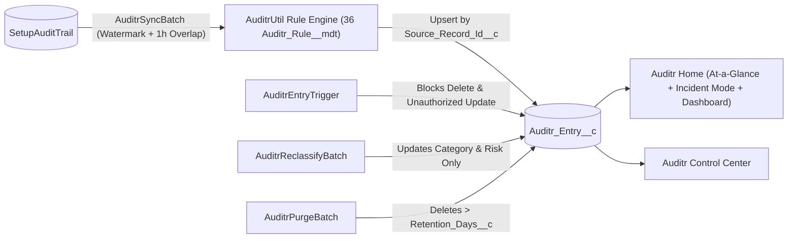

# Architecture, Data Model & Considerations

Auditr is intentionally compact — 6 production Apex classes, 1 trigger, 3 Lightning Web Components, 1 custom object, and 2 custom metadata types — so your security and engineering teams can audit the entire codebase in minutes.

---

## Package Structure

```text
force-app/main/default/Auditr/
├── applications/    Auditr Lightning App (branded with Auditr_Logo)
├── classes/         AuditrUtil · AuditrEntryTriggerHandler · AuditrSyncBatch
│                    AuditrReclassifyBatch · AuditrPurgeBatch · AuditrController
│                    + 5 test classes (90% package code coverage)
├── triggers/        AuditrEntryTrigger (before update, before delete immutability)
├── lwc/             auditrAtAGlance · auditrControlCenter · auditrRecordDetail
├── objects/         Auditr_Entry__c · Auditr_Rule__mdt · Auditr_Setting__mdt
├── layouts/         Auditr_Entry__c · Auditr_Rule__mdt · Auditr_Setting__mdt layouts
├── customMetadata/  36 classification rules + Default setting
├── flexipages/      Auditr_Home · Auditr_Control_Center · Auditr_Entry_Record_Page
├── dashboards/      Auditr_Security_Dashboard (6 components)
├── reports/         6 audit & security reports
└── permissionsets/  Auditr_Admin · Auditr_Viewer
```

---

## End-to-End Pipeline



1. **Watermark Resolution (`AuditrSyncBatch.resolveCutoffTimestamp`)**:
   - Queries the newest `Auditr_Entry__c.Occurred_At__c` where `Source__c = 'SetupAuditTrail'`.
   - Subtracts a **60-minute overlap buffer** so late-committed `SetupAuditTrail` rows are never missed across batch boundaries.
   - If no `Auditr_Entry__c` rows exist yet, falls back to `System.now().addDays(-Backfill_Days__c)`.
2. **Idempotent Upsert (`Source_Record_Id__c`)**:
   - Maps `String.valueOf(SetupAuditTrail.Id)` into `Auditr_Entry__c.Source_Record_Id__c` (`External ID`, `Unique`, `Case Insensitive`).
   - Uses `Database.upsert(entries, Auditr_Entry__c.Source_Record_Id__c, false, AccessLevel.SYSTEM_MODE)` so overlapping windows never create duplicates.
3. **Immutability Guard (`AuditrEntryTrigger` & `AuditrEntryTriggerHandler`)**:
   - **`before delete`**: Blocks all user and API deletions unless `AuditrEntryTriggerHandler.allowPurgeDelete` is explicitly set within `AuditrPurgeBatch.execute()`.
   - **`before update`**: Blocks any modification to immutable provenance fields (`Source__c`, `Source_Record_Id__c`, `Occurred_At__c`, `Actor__c`, `Actor_Username__c`, `Delegate_User__c`, `Responsible_Username__c`, `Actor_Context__c`, `Action_Code__c`, `Section__c`, `Namespace_Prefix__c`, `Display__c`). Even `Category__c` and `Risk_Level__c` can only be updated when `AuditrEntryTriggerHandler.allowReclassificationUpdate` is enabled by `AuditrReclassifyBatch` or the `auditrRecordDetail` reclassification action.

---

## Data Model (`Auditr_Entry__c`)

| Field Label | API Name | Type | Description |
| :--- | :--- | :--- | :--- |
| **Audit Entry Number** | `Name` | Auto Number (`AUD-{0000000}`) | Unique human-readable audit identifier. |
| **Occurred At** | `Occurred_At__c` | Date/Time | Original `SetupAuditTrail.CreatedDate` timestamp. |
| **Risk Level** | `Risk_Level__c` | Picklist | `Critical`, `High`, `Medium`, or `Low`. |
| **Category** | `Category__c` | Picklist | `Security & Access`, `Users & Sessions`, `Code & Automation`, `Data & Schema`, `Org Preferences`, `Packages & Integrations`, or `Unclassified`. |
| **Setup Section** | `Section__c` | Text(120) | Setup section where the change occurred (defaults to `General` when blank). |
| **Action Code** | `Action_Code__c` | Text(120) | Raw `SetupAuditTrail.Action` identifier. |
| **Responsible Username** | `Responsible_Username__c` | Text(255) | Resolved actor (`Delegate_User__c` when impersonated, otherwise `Actor_Username__c`). |
| **Actor** | `Actor__c` | Lookup(`User`) | Lookup to the `CreatedById` User record. |
| **Actor Username** | `Actor_Username__c` | Text(255) | Snapshot of `CreatedBy.Username` at the time of the event (defaults to `System` for automated actions). |
| **Delegate User** | `Delegate_User__c` | Text(255) | Populated when an admin acts via *Log in As* or delegated administration. |
| **Is Impersonated** | `Is_Impersonated__c` | Formula (Checkbox) | `NOT(ISBLANK(Delegate_User__c))` — flags delegated/impersonated actions for reports and list views. |
| **Actor Context** | `Actor_Context__c` | Text(80) | `SetupAuditTrail.CreatedByContext` value. |
| **Namespace Prefix** | `Namespace_Prefix__c` | Text(80) | `SetupAuditTrail.ResponsibleNamespacePrefix` value. |
| **Display** | `Display__c` | Long Text Area(32768) | Full human-readable description of the setup change. |
| **Source** | `Source__c` | Text(80) | Audit source (`SetupAuditTrail`). |
| **Source Record ID** | `Source_Record_Id__c` | Text(64) (External ID, Unique) | 18-character `SetupAuditTrail.Id` used for idempotent upserts. |

---

## Operational Considerations

- **Large Data Volume (LDV) Query Caps**: To keep `auditrAtAGlance` and `auditrControlCenter` fast even in orgs with hundreds of thousands of setup changes, KPI `COUNT()` queries apply defensive `LIMIT` caps (`25,000` for total counts, `5,000` for category/risk KPIs, and `10,000` for 30-day unclassified aggregation).
- **Scheduled Job Ownership**: If the admin user who scheduled `Auditr_Daily_Sync` or `Auditr_Daily_Purge` is later deactivated, the Control Center displays a prominent **Health Notice** banner prompting an active admin to click **Schedule Daily Sync** or **Schedule Daily Purge**.
- **Storage Footprint**: Each `Auditr_Entry__c` record consumes standard Salesforce custom object storage (~2 KB per record). Use `Enable_Purge__c` and `Retention_Days__c` in `Auditr_Setting__mdt` to align storage usage with your compliance retention window.
